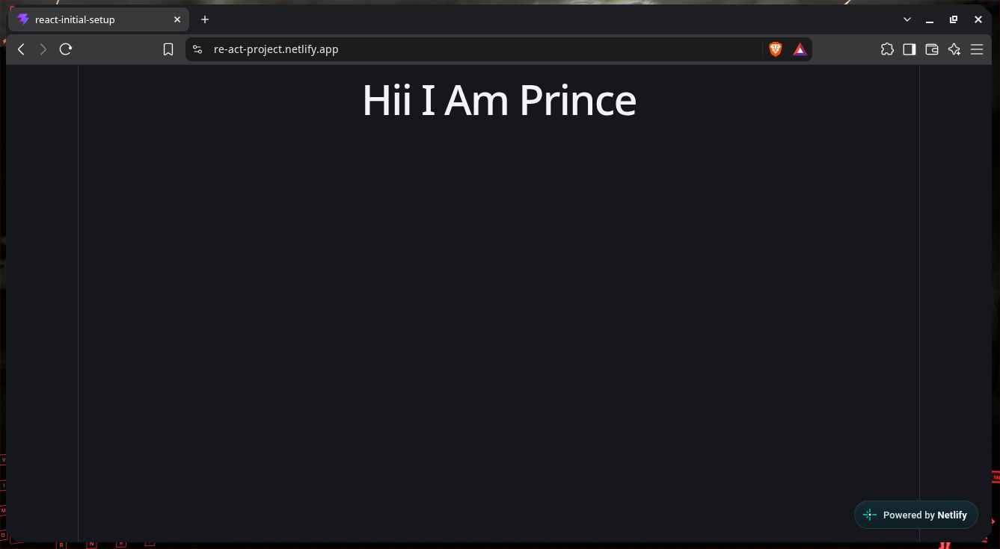

### AN SIMPLE REACT SETUP
---
## an simple project that is meant to try setting up an react by
> Installing react and deploying it
> altering the existing code to display an simple welcome message.

## Netlify host link:-
=> https://re-act-project.netlify.app
---

